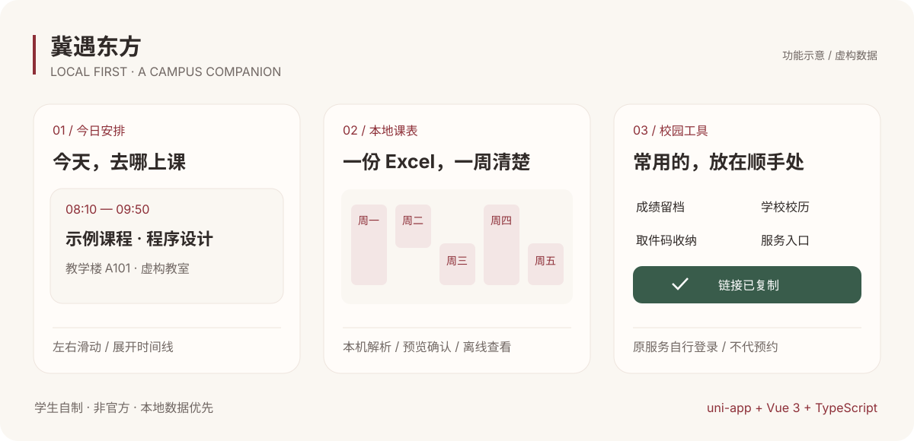

<div align="center">

# 冀遇东方 · Ji Meets Oriental

**把分散的校园日常，放到一个顺手的地方。**

河北东方学院学生自制的非官方校园助手，以本地课表为核心，整合成绩留档、校历、取件码和校园服务入口。


[快速开始](#快速开始) · [功能与边界](#功能与边界) · [开发指南](docs/DEVELOPMENT.md) · [部署说明](docs/DEPLOYMENT.md) · [参与贡献](CONTRIBUTING.md)

</div>



> 上图使用虚构内容绘制，是功能示意，不是运行截图。项目仍在持续开发，不是学校或超星的官方产品；学校通知、调课及第三方服务规则以原平台为准。

## 为什么做这个项目

课表在教务系统里，图书馆预约在学习通里，用水、点餐又是不同入口。这个项目想先把每天真正用得到的内容整理好：导入一次课表，随时查看今天去哪上课；查到成绩时留一份本机记录；零散的取件码和校园服务也有一个固定位置。

当前采用 **教务导出 Excel → 本机解析 → 预览确认 → 本机保存**。不要求用户提供教务密码，也不把拿不到的接口包装成“已经接通”。

## 功能与边界

| 模块 | 当前可以做什么 | 当前边界 |
| --- | --- | --- |
| 今日安排 | 日期、教学周、今日课程、详情、可滑动叠卡与展开时间线 | 数据来自已导入课表；浏览进度不代表完成或签到 |
| 课表导入 | `.xls` / `.xlsx`、常见网格与明细表、合并单元格、单双周、不连续周次、预览修正、同学期合并 | 不保证所有学校模板；调课后需要重新导入 |
| 周 / 日课表 | 周次切换、课程详情、学期起始日和总周数设置 | 不自动同步教务变动 |
| 成绩留档 | Excel 导入、预览、多次快照、学期筛选、课程搜索 | 真实本校成绩文件仍待开放时核对；不推算未提供的绩点 |
| 校历 | 暂行校历、教学周、日期事项、用户确认后采用学期预设 | 内置 2026—2027 学年数据，不自动更新或安排补课 |
| 取件码 | 手动添加、主动粘贴识别、预览、搜索、大字展示、已取状态 | 不读取短信或通知，不接入快递账号 |
| 校园服务 | 座位预约、用水、外卖入口指引；复制成功后绿色对勾与后续步骤 | 微信端手动打开原服务，不等同于小程序内预约、充值或点餐 |
| 底部导航 | 米白 / 绛红主题、微信半透明悬浮底栏、点击 / 拖动切换 | 真机模糊和手势性能待验证；H5 保留常规底栏 |
| 留言与统计 | 自制留言页、作者工作台及云函数源码 | **默认关闭，尚未完成线上接通与权限验收**，不会假装提交成功 |
| 在线教务适配器 | 保留早期 Express 实验源码 | 未接入当前前端，不能作为可直接上线的教务服务 |

考试安排、空教室等未实现的入口显示待开放。没有自动抢座、自动签到、代付费或绕过学校认证的功能。

## 快速开始

### 准备环境

- Node.js 24.x、npm；本地检查使用 Node.js 24.16.0 / npm 11.13.0。
- 微信端需要微信开发者工具，以及自己的小程序 AppID。
- 只体验网页或本地课表时，**不需要启动后端、购买云环境或配置 AppSecret**。

克隆本仓库后，在仓库根目录执行：

```bash
cd campus-miniapp
npm ci
npm run dev:h5
```

访问终端实际打印的地址。首次进入没有课表是正常状态，不会自动写入演示课程。

### 微信开发者工具

公开版 `campus-miniapp/src/manifest.json` 使用游客占位 AppID。改成自己的 AppID 后：

```bash
cd campus-miniapp
npm run dev:mp-weixin
```

导入 **`campus-miniapp/dist/dev/mp-weixin`**。生产构建则导入 **`campus-miniapp/dist/build/mp-weixin`**，不要混用。本地功能无需选择作者云环境；微信特有能力请用自己的有效 AppID 做真机验证。

### 没有学校文件，也能试导入

```bash
cd campus-miniapp
npm run fixtures
```

这会在 `test-fixtures/` 生成 4 份自造 Excel。微信中可先发到文件传输助手，再在「导入课表」选取；H5 可直接选择文件。检查预览、学期名称和第一教学周的周一后，再确认保存。示例不含真实学生数据。

学校导出路径和已知格式见 [开发指南](docs/DEVELOPMENT.md#课表导入)。

## 项目结构

```text
.
├── campus-miniapp/                # uni-app + Vue 3 + TypeScript
│   ├── src/pages/                 # 首页、课表、校园、我的及各服务页
│   ├── src/pages-import/          # 课表 / 成绩导入分包与解析
│   ├── src/domain/                # 课程、成绩、校历、取件码规则
│   ├── src/services/              # 本地存储与可选云端调用
│   ├── src/components/            # 复用组件与复制反馈
│   ├── src/custom-tab-bar/        # 微信原生自定义底栏
│   ├── tests/                     # Vitest 回归测试
│   └── scripts/                   # 自造文件 / 图标生成脚本
├── campus-server/
│   ├── src/                       # 实验性 Express 教务适配器
│   └── cloudfunctions/            # 可选留言统计与登录桥接
├── docs/                          # 开发、部署、隐私与参考资料
└── .github/                       # CI、Issue 和 PR 模板
```

SheetJS 0.20.3 在本地读取 Excel，Vitest / vue-tsc 执行检查，云端候选方案使用 CloudBase。前后端各自管理依赖，没有根目录 npm workspace。

## 验证

```bash
cd campus-miniapp
npm run typecheck
npm test
npm run build:h5
npm run build:mp-weixin
```

在仓库根目录运行云函数隔离测试，不需要连接真实云环境：

```bash
node --test campus-server/cloudfunctions/campusBackend/tests/*.test.cjs
node --test campus-server/cloudfunctions/campusLogin/tests/*.test.cjs
```

此前已在微信开发者工具验证本校课表导入 / 保存、课程切换、悬浮底栏和多个复制入口的真实成功回调。**构建或替身测试通过，不等于真机兼容、云函数已部署或所有学校模板都能解析。** GitHub Actions 的首次远程结果以仓库运行记录为准。

## 数据与隐私

- 课表、成绩与取件码只保存在当前设备；原 Excel 请自行保留。
- 清除小程序数据、卸载或更换设备可能丢失本机记录。
- 复制入口需要主动点击，不会代替用户预约、登录或付款。
- `COMMUNITY_READY` 默认为 `false`；完成自己的部署、权限隔离和真机验收后才应启用。
- 公开版不包含作者的私钥、AppSecret、云环境标识、手机调试状态、真实课表文件或原始校历附件。

详见 [数据与隐私](docs/PRIVACY.md)、[安全问题报告](SECURITY.md)。

## 适配、贡献与计划

欢迎改进 Excel 解析、补充匿名回归用例、修复无障碍问题、记录真机兼容性，或提供可验证的官方入口。其他学校请先替换校历、节次时间和服务地址，再逐项验证。

- [贡献指南](CONTRIBUTING.md)：提交 Bug、建议或 PR。
- [部署说明](docs/DEPLOYMENT.md)：自己的 AppID、服务入口与可选云端。
- [更新记录](CHANGELOG.md)：已做内容与未发布状态。
- [开源参考](docs/REFERENCES.md)、[第三方声明](THIRD_PARTY_NOTICES.md)：参考用途和许可边界。

近期重点是完善真实文件兼容与真机验收、接通并验证自制留言 / 统计、整理校园配置。在线教务同步、空教室及其他服务取决于合法可用的官方接口与维护能力，没有承诺完成日期。

## License

原创代码与自绘图标采用 [MIT License](LICENSE)。依赖库、学校名称、第三方服务及外部数据分别遵守原有权利与规则；MIT 不授予访问学校系统或使用第三方品牌的额外权限。
