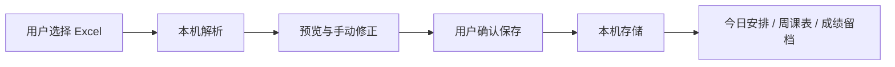

# 开发指南

## 先运行哪个部分

默认只运行 `campus-miniapp/`：页面 → 领域规则 → 本机存储。不需要教务账号、Express 服务或云数据库。

## 安装与命令

在 `campus-miniapp/` 执行 `npm ci`，使用已提交的锁文件。Windows PowerShell 可将 `npm` 写成 `npm.cmd`。

| 命令 | 用途 |
| --- | --- |
| `npm run dev:h5` | H5 本地开发，地址以终端为准 |
| `npm run dev:mp-weixin` | 微信开发监听，输出 `dist/dev/mp-weixin` |
| `npm run typecheck` | Vue / TypeScript 检查 |
| `npm test` | 领域规则、导入与导航回归 |
| `npm run fixtures` | 生成自造 Excel 样例 |
| `npm run build:h5` | H5 生产构建，输出 `dist/build/h5` |
| `npm run build:mp-weixin` | 微信生产构建，输出 `dist/build/mp-weixin` |

uni-app 相关包锁定同一构建版本；SheetJS 来自官方 CDN 0.20.3。不要单独升级一个 uni-app 包，或将其替换成不同版本的 xlsx。

## 保存源码后模拟器没更新

微信运行的是生成的 WXML / WXSS / JS，单独点微信「编译」不会转换 Vue 源码。

1. 修改 `campus-miniapp/src/`，等待监听显示 `DONE Build complete`。
2. 核对开发者工具导入 `dist/dev/mp-weixin` 还是 `dist/build/mp-weixin`。
3. 仍有旧内容时，仅清除当前项目的**编译缓存**再编译。不要清除模拟器数据或全部缓存，以免删除本地课表。

## 核心代码位置

| 需求 | 优先查看 |
| --- | --- |
| 服务入口、弹窗和跳转 | `src/domain/home.ts` 的 `CAMPUS_SERVICES` / `openCampusService` |
| 课表规则、周次与节次 | `src/domain/schedule.ts` |
| 课表 / 成绩 Excel 解析 | `src/pages-import/excel.ts`、`grades-excel.ts` |
| 课表 / 成绩持久化 | `src/services/storage.ts`、`grades.ts` |
| 取件码识别与保存 | `src/domain/pickups.ts`、`src/services/pickups.ts` |
| 复制反馈 | `src/components/CopyLinkButton.vue`、`FeedbackButton.vue` |
| 微信悬浮底栏 | `src/custom-tab-bar/`、`src/composables/useTabBar.ts` |
| 留言服务开关 | `src/services/community.ts` |

Vue 使用 Composition API 与 `<script setup lang="ts">`。页面负责组合与流程，规则尽量放在可测试的领域模块；不要为一次文案修改重构整套导航。

## 课表导入

本校当前路径：登录教务 → 进入首页 → 培养管理 → 我的课表 → 学期理论课表 → 导出。学校页面变化时请更新并实测。

- `.xls` / `.xlsx`，以及部分以 `.xls` 后缀导出的 HTML 表格。
- 单文件最大 5 MB，最多 20 张工作表，每张最多 500 条排课。
- 网格 / 明细、合并单元格、单双周、不连续周次；未知周次与节次提示修正，不默认补成整学期。
- 取消、解析失败、空结果不得覆盖旧课表。替换与合并均由用户确认，不跨学期合并，不写回原 Excel。

本校一种真实 BIFF8 格式已验证，不保证所有模板。贡献样例时删除姓名、学号、联系方式和成绩，最好用自造文件复现。

## 适配与平台差异

- 校历：`src/domain/academic-calendar.ts`，使用前核对当前通知。
- 上课时间：`src/domain/schedule.ts`；未知节次显示“时间待确认”。
- 业务入口：`campus-water.ts`、`campus-takeout.ts`、`library-seat.ts`。
- 公开版移除作者用水入口共享参数，确认自己有权公开对应入口后再配置；未配置时按钮保持不可用。
- 微信底栏为原生组件，uni-app 直接复制该目录，不是普通 Vue 文件。
- H5 / 微信的文件选择、剪贴板和导航能力不同，一端通过不能代替另一端验证。

## 验证约定

先跑相关测试，再做类型检查和受影响平台构建。涉及手势、文件选择、复制或缓存时，记录实际平台与结果。云端替身测试不能代替身份、权限和收信验证。

首次公开提供源码与检查命令；Actions 是否通过以远程运行记录为准。不要提交个人课表、成绩、调试日志、设备配对状态或私钥作为复现材料。
